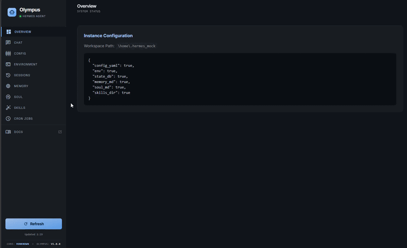

# 🏛️ Olympus - Hermes Agent Dashboard

An interactive UI dashboard for the Hermes Agent ecosystem.

[](#-migrating-to-the-native-hermes-dashboard)
[](https://opensource.org/licenses/MIT)
[](https://www.python.org/downloads/)
[](https://fastapi.tiangolo.com/)
[](https://tailwindcss.com/)

---

> [!WARNING]
> **Olympus is deprecated and no longer maintained.**
>
> Hermes Agent now ships with its own **native web dashboard** (`hermes dashboard`). It covers everything Olympus did (two-way chat, config and API key editing, memory, and skills) and adds much more. Please switch to it. See [Migrating to the native Hermes dashboard](#-migrating-to-the-native-hermes-dashboard) below.
>
> This repository is archived and read-only. Issues and pull requests are no longer accepted.

> **Disclaimer:** This was an unofficial, experimental project I built to learn about agentic systems and orchestration. It is **not affiliated** with Nous Research. Provided as-is.

---

## 🔀 Migrating to the native Hermes dashboard

### Quick start

1. **Update Hermes Agent** to a recent version that includes the dashboard.
2. **Launch it:**
   ```bash
   hermes dashboard
   ```
   This starts a local web server and opens **http://127.0.0.1:9119** in your browser.

Useful flags:

| Flag | Default | Description |
| :--- | :--- | :--- |
| `--port` | `9119` | Port to run the web server on |
| `--host` | `127.0.0.1` | Bind address (see the security note below) |
| `--no-open` | none | Don't open the browser automatically |

If dependencies are missing, `hermes dashboard` tells you what to install. If they are damaged, run `hermes pm repair` and restart Hermes.

📖 Official docs: [Hermes Agent: Web Dashboard](https://hermes-agent.nousresearch.com/docs/user-guide/features/web-dashboard)

### Where each Olympus feature lives now

| Olympus feature | Native dashboard |
| :--- | :--- |
| Two-way chat with the agent | **Chat** tab: embeds the real `hermes --tui` in the browser, with session switching and resume |
| Editing `config.yaml` | **Config** tab: form editor with import/export |
| Editing `.env` / API keys (redacted) | **API Keys** tab: grouped by provider, redacted previews |
| `MEMORY.md` / `USER.md` | **System › Memory**: memory provider selection and reset of built-in memory |
| Skill management | **Skills** tab: browse, search, toggle, and install from the hub |
| *(not in Olympus)* | **Sessions** (full-text search, export), **Logs**, **Analytics** (token/cost usage), **Cron**, **Profiles**, **MCP**, **Webhooks**, gateway control, and more |

### Platform notes

- The **Chat** tab needs a POSIX terminal (Linux, macOS, or **WSL2**). On native Windows the rest of the dashboard works, but the Chat tab asks you to use WSL2.
- The dashboard edits the same `~/.hermes` files Olympus used (`config.yaml`, `.env`, memory files, `state.db`). **There is no data to migrate.**

### Security

By default the dashboard binds to `127.0.0.1` with no login, so only your machine can reach it. If you bind it to any other address (for example `--host 0.0.0.0`), Hermes refuses to start until you configure an auth provider (username/password or OAuth). The dashboard can read and write your API keys, so never expose it publicly without authentication.

### Removing Olympus

1. Stop the Olympus server (`Ctrl+C` in the terminal running `./start.sh`).
2. Delete the cloned `Olympus` folder, including its `venv/`.

Olympus never stored data outside `~/.hermes`, so nothing else needs cleaning up.

---

## 🙏 Thank you

Thanks to everyone who tried Olympus, opened issues, or shared feedback. Seeing the Hermes team ship an official dashboard is the best possible outcome for a project like this.

---

## Overview (historical)



**Olympus** bridged the gap between the Hermes Agent CLI and a modern web interface. It gave a "God's eye view" of your local `~/.hermes` environment, with real-time interaction and state management.

### Key Features:
* **Two-Way Chat:** Full interactive session support (not just read-only).
* **State Visualization:** Live polling of active memory and environment variables.
* **Skill Management:** Toggle and inspect agent skills via a clean UI.
* **Zero-Config Setup:** Automated environment provisioning.

## 🛠️ Core Tech Stack

| Layer | Technology | Purpose |
| :--- | :--- | :--- |
| **Backend** | FastAPI / Python | Subprocess orchestration & JSON-RPC bridging |
| **Frontend** | Vanilla JS / Tailwind | Lightweight, responsive interface |
| **Markdown** | Marked.js | Real-time rendering of agent responses |

<details>
<summary><strong>Legacy instructions (unsupported)</strong></summary>

### Prerequisites
- **OS:** Linux, macOS, or WSL2 (Hermes requires a Unix-like environment).
- **Python:** 3.10 or higher.
- **Hermes:** A configured [Hermes Agent](https://github.com/NousResearch/hermes-agent) installation.

### Installation & Launch
1. **Clone the repository:**
   ```bash
   git clone https://github.com/gusperroni/Olympus.git
   cd Olympus
   ```

2. **Run the bootstrap script:**
   This script creates a virtual environment, installs dependencies, and starts the server.
   ```bash
   chmod +x start.sh
   ./start.sh
   ```

3. **Access the Dashboard:**
   Navigate to **http://127.0.0.1:8787** in your browser.

</details>

---

## Built via Agentic Orchestration

The entire codebase was engineered through a **3-Layer Domain-Driven Design (DDD)** methodology utilizing an AI-assisted orchestration loop:

1. **Strategic Intent:** Business logic and aesthetics (build with the help of [Stitch](https://stitch.withgoogle.com/)) were dictated through high-level markdown directives.
2. **Deterministic TDD Execution:** Every backend feature was written against strict Test-Driven Development mandates. The API endpoint suite reached **87% backend code coverage** executed entirely under automated AI testing sprints.
3. **Self-Annealing Loop:** The orchestration dynamically verified asynchronous states against live CLI models, iterating until the UX remained cleanly non-blocking.

## Credits
- A huge shoutout to [Mayur](https://github.com/mayurjobanputra/) and his [Hermes Dashboard](https://github.com/mayurjobanputra/hermes-dashboard) work for the initial prompt engineering concepts and "vibe" that helped bootstrap the core logic of Olympus. While I aimed to evolve Olympus into a standalone interactive platform with unique orchestration, Mayur's work was the essential spark for this project.

- [Hermes-Agent ☤](https://github.com/nousresearch/hermes-agent) by [Nous Research](https://nousresearch.com/).


## License
Distributed under the MIT License. See `LICENSE` for more information.
